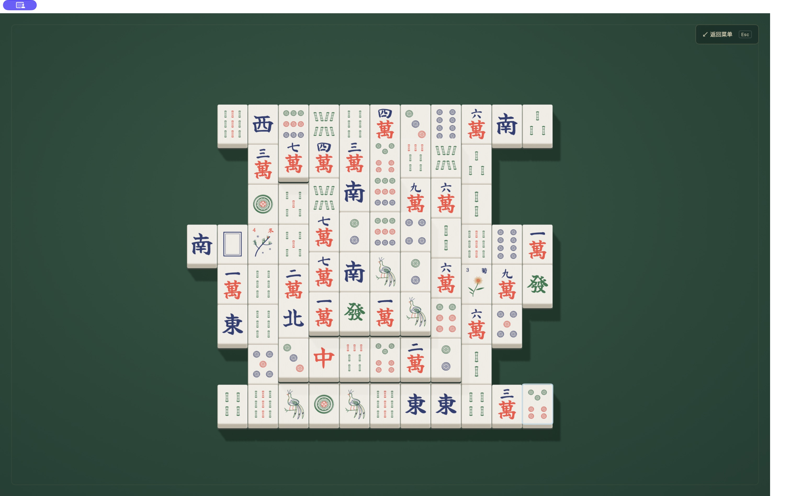

# 叠影 · Mahjong Solitaire for macOS

在 Mac 上独立运行的立体麻将应用，包含经典对对碰、数学教学工坊和认牌馆。AppKit 提供原生窗口和菜单，macOS 自带 WebKit 绘制 3D 牌阵。模型、贴图、普通话配音和音效均可离线使用，无需打开浏览器，也不需要本地 HTTP 服务。



## 功能

- 经典龟形、双桥、小花园三种牌阵；提示、撤销、可解洗牌与编号重玩。
- 暖象牙、竹制、白瓷三种材质，每套包含 42 种立体牌面。
- 鼠标点击选牌，拖动转动视角，滚轮缩放；支持沉浸牌桌与 Mac 原生全屏。
- 普通话配音、按材质区分的碰牌声，开关分别保存。
- 自动保存牌局，退出后重开可以续局。
- 数学教学工坊有 16 个小游戏、69 个关卡。牌面随窗口放大，桌面支持沉浸模式。点牌、提交和判定都有短音效，可在工坊设置中关闭。
- 认牌馆展示 42 种凹刻牌面，可旋转、翻面、近看刻纹，提供中英名称、拼音和认牌练习。

## 编译并安装

运行要求 **macOS 14 或更新版本**。源码编译需要 Xcode，或带有 macOS SDK 的 Command Line Tools。

```sh
git clone https://github.com/willrong1971/dieying-macos.git
cd dieying-macos
./macos/build.sh --universal --install
```

也可在项目根目录双击 `编译安装Mac版.command`。

- `--universal` 编译 Apple 芯片与 Intel 通用程序。
- `--install` 安装到 `/Applications/叠影.app`；省略时只生成 `dist/macos/叠影.app`。
- 安装前先退出正在运行的旧版。已安装的本应用会先备份到 `dist/macos/previous/`。
- 构建使用本机临时签名，未配置 Developer ID、公证和自动更新。
- 编译和运行不需要安装 npm 依赖、Blender、Python 第三方包或语音大模型。

生成 DMG 安装包：

```sh
./macos/package.sh
```

输出 `dist/macos/叠影-1.0.0-通用版.dmg`。详细操作、存档位置与原生测试命令见 [Mac 开发说明](macos/README.md)。

## 操作

点击一张可取牌作为首牌，再点另一张判断配对；错配时保留首牌。再点首牌或空桌面取消选择。鼠标左键拖动转视角，Shift 拖动平移，滚轮缩放。

| 快捷键 | 操作 |
| --- | --- |
| I / Esc | 进入 / 退出沉浸牌桌 |
| ⌘N | 新牌局 |
| ⌘P | 暂停 / 继续 |
| ⌘T / ⌘Z / ⌘R | 提示 / 撤销 / 洗牌 |
| ⌘0 | 视角复位 |
| ⌘1 / ⌘2 / ⌘3 | 对对碰 / 数学工坊 / 认牌馆 |
| ⌃⌘F | 原生全屏 |

本机自动存档位于 `~/Library/Application Support/DieYing/saved-games.json`，与网页浏览器的存档分别保存。

## 源码结构

- `macos/Sources/`：AppKit 窗口、菜单、WebKit 资源协议与原生存档。
- `macos/Resources/`：应用图标和 JavaScript 存档桥接。
- `macos/scripts/prepare-assets.py`：将运行资源复制入 App，并生成 SHA-256 清单。
- `src/`、`solitaire.html`、`index.html`、`tile-studio.html`：3D 牌桌、配对引擎、数学工坊与认牌馆。
- `exports/v2/game/`：三套自包含 GLB 牌模。
- `public/tiles/`、`public/audio/`：牌面预览、离线语音与牌声。
- `vendor/three/`：随项目保存的 Three.js。
- `tests/`、`macos/tests/`：游戏、资源打包、原生存档与资源协议测试。

本仓库提供独立版的完整编译输入及测试资源。大型 Blender 工程、高精度渲染、中间纹理、开发机测试记录、应用构建产物和个人存档未纳入仓库。GLB 的几何与贴图数据保留，开发机绝对路径元数据已改成相对说明。

## 测试与网页预览

需要 Node.js 运行自动测试：

```sh
npm ci
npm test
node --test macos/tests/native-bridge.test.mjs
python3 -m unittest discover -s macos/tests -p 'test_*.py' -v
```

Mac 编译与运行使用已随仓库保存的运行库，不需要 npm 安装；自动测试需要先执行 `npm ci`。若要更新随仓库保存的 Three.js，可运行 `npm install` 与 `npm run prepare:vendor`。

网页预览可执行 `npm start`，然后打开 `http://localhost:8787/solitaire.html`；Mac 独立版运行不依赖该服务。

第三方组件和字体说明见 [THIRD_PARTY_NOTICES.md](THIRD_PARTY_NOTICES.md)。
